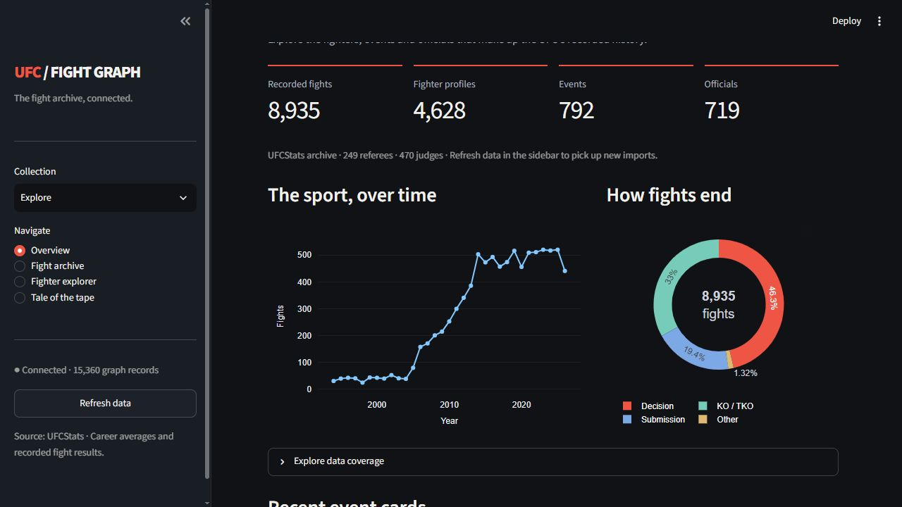
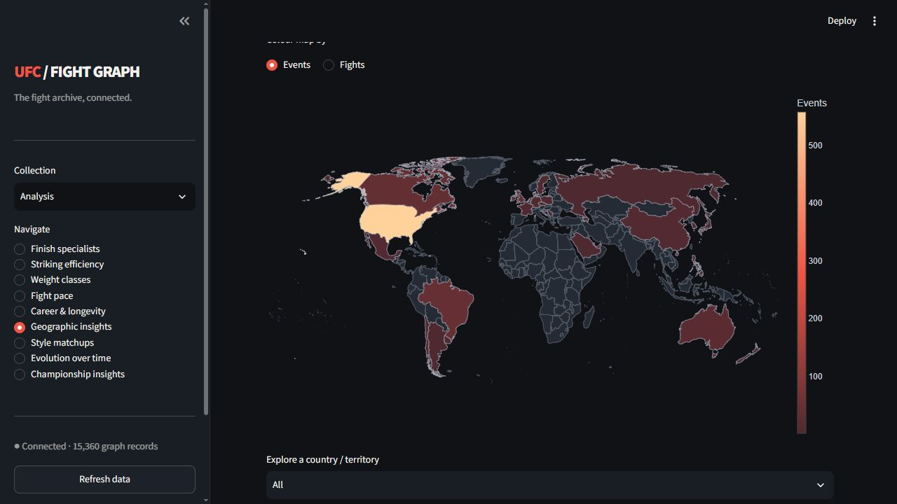

# UFC Fight Graph

A searchable [UFCStats](http://ufcstats.com) archive connecting fighters, fights,
events and officials in Neo4j. The Streamlit dashboard lets you follow a fighter's
opponents, inspect who officiated a bout, compare careers and explore where events
took place.



## Data snapshot · 13 October 2026

| Imported records | Count |
|---|---:|
| Fights | 8,935 |
| Fighter profiles | 4,628 |
| Events | 792 |
| Referees | 249 |
| Judges | 470 |

The graph contains **15,360 nodes and 57,759 relationships**. Named judge totals
are present for **4,064 fights**: 4,041 decisions and 23 overturned results.
See the [judge-coverage audit](docs/DATA_OPERATIONS.md#judge-coverage) for complete,
partial and missing records.

## Explore the graph

The dashboard groups pages into Explore, Officials, Analysis and Network:

- Search fights by fighter, event, referee or location; filter by year, division,
  result type or title status, then export matching rows to CSV.
- Open a fight to inspect participants, results, referee and published judge totals.
- Compare fighter profiles, head-to-head meetings and common opponents.
- Browse referee assignments, judge scorecards and opponent networks.
- Explore event and fight counts on a world map, then filter host locations and
  methods by country or territory. Source links lead back to UFCStats.



The crawl resumes from committed checkpoints, and fight-detail backfills retry
unfinished work. Portable graph ZIPs support recovery into an empty database;
the local Google Drive uploader verifies each uploaded backup. Operational details
are in [data operations and recovery](docs/DATA_OPERATIONS.md).

## Setup

Python 3.11–3.13 and Neo4j 5.26 LTS are the supported baseline.

```powershell
python -m venv .venv
.\.venv\Scripts\Activate.ps1
python -m pip install -r requirements-dev.txt
Copy-Item .env.example .env
```

Set `NEO4J_URI`, `NEO4J_USER`, `NEO4J_PASS` and optionally `NEO4J_DATABASE` in
`.env` or the environment. Environment values take precedence. `--env-file`
selects another file for command-line tools. For Aura, copy its `neo4j+s://` URI,
username, password and database into these settings; downloaded credential files
and `.env` stay outside Git.

Install Neo4j using the [Windows ZIP instructions](https://neo4j.com/docs/operations-manual/current/installation/windows/),
or use Docker with a **named volume**:

```sh
docker run -d --name ufc-neo4j -p 7474:7474 -p 7687:7687 -v ufc-neo4j-data:/data -e NEO4J_AUTH=neo4j/change-me neo4j:5.26
```

Store native Neo4j data outside the application installation directory. Keep a
backup before replacing a database or removing its volume. The configured Windows
installation starts with `powershell -File tools/start_neo4j.ps1`; see
[native Windows setup](docs/DATA_OPERATIONS.md#native-windows-neo4j).

## Run

```sh
python run_crawl.py --events-only --limit 5
python run_crawl.py
python run_dashboard.py
```

Events load first, followed by details for every eligible fight (including referees,
results, title status and judge totals), then fighter profiles. `--limit` bounds
new events/fighters per stage; detail enrichment processes the database backlog.
`--skip-details` imports summaries for later enrichment. `--fighters-only` refreshes
profiles separately. Default concurrency is two HTTP workers with at least one
second between requests per worker. `--workers` and `--delay` apply to every stage,
including fight details. Database writes and checkpoint updates remain serial.

A successful database write precedes every checkpoint. Failed URLs remain eligible
for retry. Re-running the crawl discovers new records; `--reset` rebuilds the
checkpoint and refreshes existing records without clearing the graph. Use it to
refresh fighter career statistics or after restoring/recreating a database.

```sh
python run_crawl.py --status
python run_crawl.py --fighters-only --reset
python run_backfill.py --dry-run
python run_backfill.py
python run_backup.py
python run_backup.py --restore backups/ufc-graph-TIMESTAMP.zip
```

The dashboard opens on port 8501. Backups preserve the project's graph nodes,
properties and relationships, with a checksum manifest. Restore targets an empty
database and preserves Neo4j temporal types. Upload the ZIP to Google
Drive for an off-machine copy. See [backfill and recovery](docs/DATA_OPERATIONS.md).

Archive reads are cached for two minutes. **Refresh data** reloads the archive after
an import. Career averages and records can include bouts outside the stored UFC
history; published judge totals describe final totals rather than round-by-round
scorecards.

Use `python run_crawl.py --backup-dir backups` to export a snapshot after the crawl.
Add `--upload-drive` after configuring the [direct Google Drive uploader](docs/DATA_OPERATIONS.md#direct-google-drive-uploads)
to upload the final snapshot independently of Codex. It validates the archive,
checks the uploaded file's name, size and checksum, and saves a verification receipt.
An existing crawl can use `powershell -File tools/start_upload.ps1` to attach a local
completion watcher.

## Development

```sh
python -m pytest -m "not integration"
python -m ruff check .
python -m ruff format --check .
```

Integration tests use an explicitly configured disposable Neo4j database. See
[CI setup](docs/CI_CD_SETUP.md). Offline tests use small source-shaped fixtures,
so network availability does not affect CI.

- [Architecture and graph schema](docs/ARCHITECTURE.md)
- [Data operations and backups](docs/DATA_OPERATIONS.md)
- [Analytics definitions](docs/NETWORK_RESEARCH.md)
- [Code and history audit](docs/AUDIT.md)
