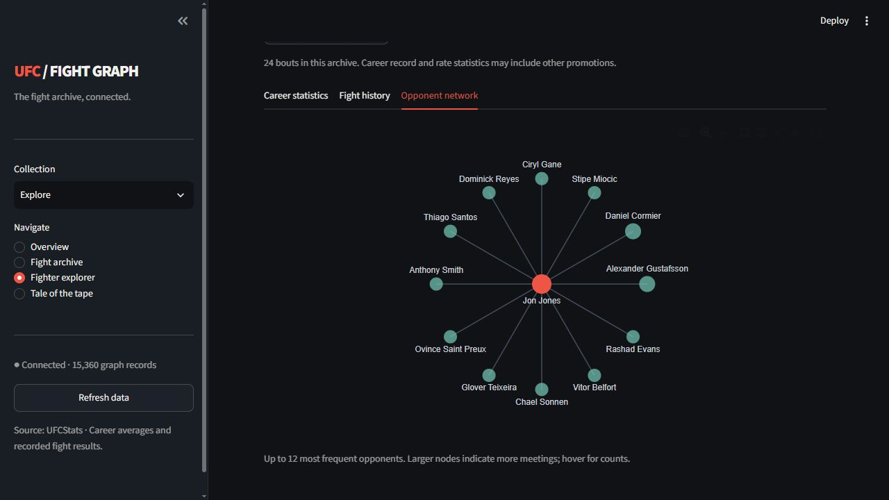
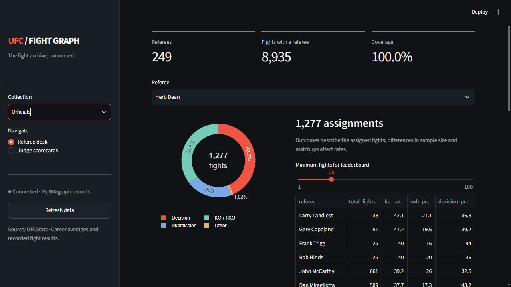
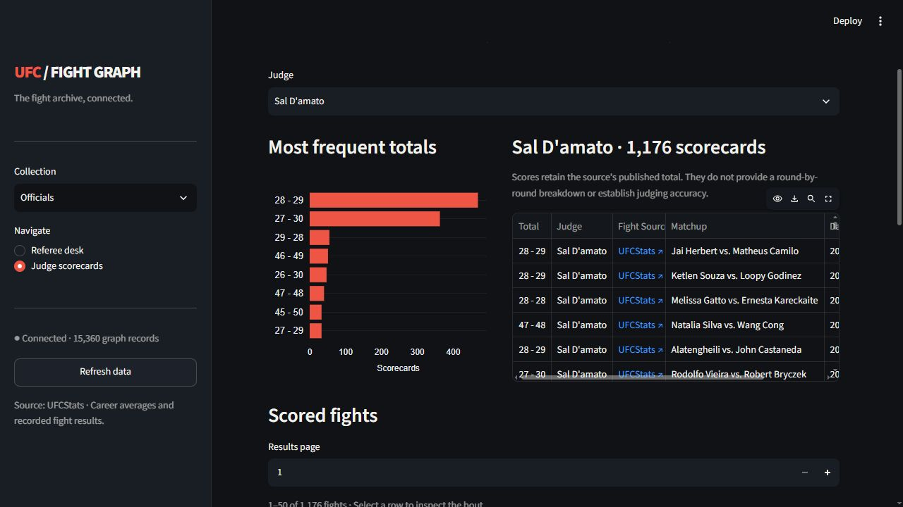
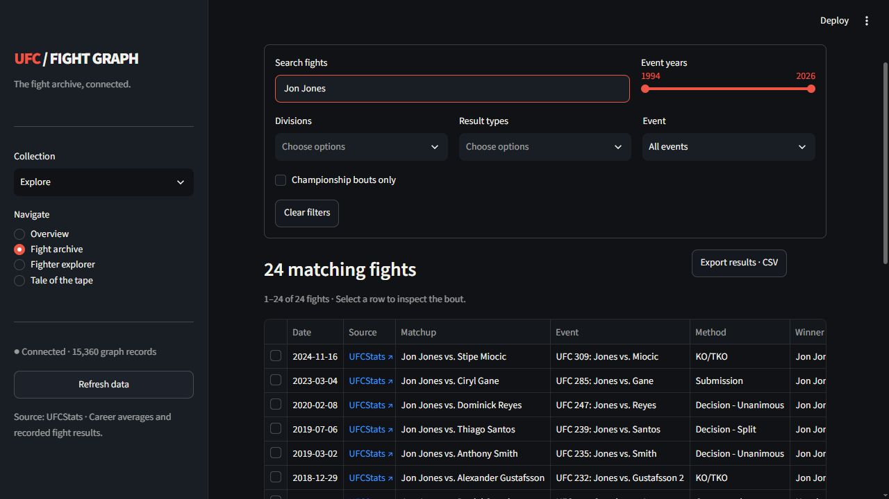

# Rebuilding UFC Fight Graph with Neo4j and Streamlit

[Explore the live dashboard](https://ufc-fight-graph.streamlit.app/)

I rebuilt UFC Fight Graph after the database was lost. The result is a connected archive of 8,935 fights, 4,628 fighter profiles and 792 events, with a Streamlit interface for exploring the records. The rebuild also gave me a reason to inspect what the code actually did, remove duplicate paths, and make recovery part of the application.

*Completed archive overview. Snapshot reviewed 13 October 2026.*

## The questions behind the graph

A fight result is useful on its own. It becomes more useful when I can follow its connections: the athletes involved, the event, the location and the officials. I wanted to move between those records without repeatedly assembling a new spreadsheet or searching individual pages.

Neo4j stores those connections explicitly. A fighter participates in a fight, a fight belongs to an event, and an event takes place at a location. Referees connect to the fights they officiated. Judge relationships retain the published score total. The current snapshot contains 15,360 nodes and 57,759 relationships.

The interface makes that structure approachable. A fighter page combines source career statistics with the bouts held in this archive. Its opponent view shows up to 12 frequent opponents, with larger nodes for repeated meetings. It is a useful starting point for exploring a career, while the fight history provides the underlying records.

The benefit for this project is the continuity of the questions. I might start with an event, inspect one bout, open a participant's profile, then look at an opponent they have faced more than once. Each step follows a relationship already present in the graph. The same records support an officials view without requiring a separate copy of the fight archive. I chose that model because the connections are part of the subject I want to explore.

The schema also makes the meaning of each record visible. A fighter node represents a source profile. A fight node represents a bout. The participation relationship carries the athlete's result, while a judge relationship carries the published score. Keeping those meanings explicit helps when reviewing queries or explaining a result to someone who has never seen the code. It also makes it easier to identify which information the current model has yet to capture.

*Jon Jones in the opponent network view. Node size reflects meetings in the imported archive. The view displays up to 12 opponents.*

## Cleaning the implementation before rebuilding the data

The commit history described an architecture refactor, but the checkout still contained earlier implementations alongside newer ones. There were duplicate scraper paths, two dashboard implementations and abstractions that the running application never imported. Keeping all of them made the code harder to reason about.

I consolidated the application around one HTTP scraper, one graph writer and one dashboard. The documentation now focuses on setup, schema, operations, recovery and the definitions behind the analytics. The audit records why obsolete files were removed, and Git retains their history.

One important repair concerned identity. Names alone can merge distinct fighters. The graph now keys fighter records by their UFCStats URLs, and the dashboard distinguishes profiles with duplicate names. Updates also preserve populated properties when a later source record is sparse.

I paid particular attention to behaviour that could make a crawl appear more complete than it really was. The earlier implementation could checkpoint discovered work before every database operation finished, and some failure paths obscured write errors. The revised flow surfaces failures and records individual committed work. That repair matters more than an impressive module diagram because it changes what the progress report actually means.

I also reviewed the tests and deployment entry points. Parser fixtures now let the offline tests exercise source-shaped HTML without depending on a live website. Database integration tests use a deliberately configured disposable Neo4j instance. The container entry point matches the retained Streamlit application. Together, those changes make the documented workflow closer to what someone gets when they check out the repository and try to run it.

Documentation cleanup followed the same principle. I removed overlapping plans, diagnostic litter and claims that exceeded the implemented analytics. I retained the explanations someone needs to operate or extend the application. When a network measure uses a heuristic, its definition says so. That lets a reader decide whether the measure answers their question before they interpret a ranking.

## A crawl that can continue after interruption

The rebuild imports event records first, enriches eligible fights from their detail pages, and then loads fighter profiles. Fight enrichment adds both participant outcomes, dates, title status, referees and published judge totals. Separating those stages makes the remaining work visible.

A checkpoint follows a successful database write. A failed URL remains eligible for another attempt. This is important because a saved list of discovered URLs does not prove that their data reached the database.

When I accelerated the remaining crawl, I kept the completed records and increased the HTTP worker count. Each worker owns its session and request pacing. Database writes and checkpoint updates remain serial. That change improved the structure of the remaining work without requiring a fresh start. I have not published a controlled speed benchmark.

The completed run provides a dated snapshot, rather than a promise that every source field is present. That distinction became particularly clear when I reviewed judges.

The backfill path is useful for records that already exist but need enrichment or a local repair. It can report coverage before making changes, then revisit eligible detail records. A successful detail read carries a version and a checked timestamp. This helps distinguish a page that has been examined from one that still needs attention. An empty source field can therefore remain an honest data gap rather than silently becoming an invented value.

Recreating a database also requires care with checkpoint scope. A progress file from an older database cannot, by itself, prove that a replacement database contains those records. The checkpoint design is scoped to the configured database, and the documented refresh path rebuilds progress while updating existing records. That gives me a controlled way to reconcile the source, the graph and the state used to resume a run.

The frontend can remain useful while the import proceeds. It reads the available graph through a cached catalogue, and the refresh control reloads that view after new data arrives. This was useful during the rebuild because I could inspect actual records before every profile had finished loading. The final figures in this article come from the completed snapshot, rather than one of those intermediate states.

## What the referee view adds

The Referee desk provides a useful example of connecting a new type of record to the existing archive. Selecting a referee brings together the associated bouts and their outcomes. I can inspect assignments over the recorded history and move to an individual fight for more context. The snapshot contains a referee for every stored fight, giving this part of the interface complete assignment coverage within the imported archive.

That still leaves room for careful interpretation. A referee assigned to a different mix of divisions, eras or matchups can have a different distribution of finishes. The dashboard includes a minimum-fight threshold for its leaderboard and keeps the interpretation near the outcome chart. I use this page to find records worth investigating, rather than treat the distribution as a verdict about an official.

*The Referee desk shows full assignment coverage and a selected official record. The outcome distribution describes those assigned fights.*

## Officials and the difference between fetching and coverage

The graph contains 249 referees and 470 judges. All 8,935 recorded fights have a referee. Judge coverage is more uneven, so I checked the decision fights separately instead of treating one headline number as complete coverage.

Of 4,139 decision fights, 4,034 have all three named judges and totals. Seven have only one or two named judges, and 98 have no named judges. Within those 98, the raw fight details retain anonymous totals for 42 fights. The other 56 have no totals recorded.

This also explains the dashboard figure of 4,064 fights with scorecards: 4,041 decision fights have at least one named judge, and 23 overturned results retain scorecards. Source spot-checks found missing names or empty details on UFCStats itself. Filling those gaps requires another source and a clear record of where the extra information came from.

These records contain final judge totals. They do not provide a round-by-round scoring history. Likewise, a referee outcome breakdown describes the fights assigned to that referee. It does not establish officiating quality or a causal effect on results. Those distinctions belong beside the analysis, where readers can use them.

The names and scores retain the source's published meaning. I do not reinterpret an anonymous total as belonging to a particular judge merely because that judge appeared at another fight on the event. Filling a gap responsibly means finding evidence for that exact bout. If another source supplies the missing information, the enrichment should retain the new source alongside the original record so a later review can reconstruct the change.

This is also why I find coverage reporting useful as a product feature. A user looking at judge totals deserves to know whether a fight has three names, a partial set or only raw anonymous scores. Those states affect the questions that can be answered. The audit gives the aggregate picture, while the individual fight view keeps the available details accessible.

*The judge view links published final totals to individual fights. Its scorecards describe final totals and do not establish judging accuracy.*

## Checking an individual result

A search interface should make it easy to move from an interesting summary to the record behind it. The fight archive supports searches across fighter names, events, referees and locations. The year, division, result and title filters let me narrow the question before reading the table. Pagination keeps a large archive usable, and CSV export provides a simple route for a separate analysis of the matching rows.

Selecting a fight shows both participants and their recorded outcomes, along with the method, round and time. The available referee and judge totals appear beside the bout. Links to the source fight and event pages provide a direct way to check the import. That connection between the overview and the original record is especially useful when a result has changed or the published details contain a gap.

The read layer also has to respect the graph's shape. A fight can connect to multiple participants and judges. A careless query can multiply rows across those relationships and inflate a count. The explorer catalogue instead returns one row per fight, with nested participant and scorecard data. That keeps search results and exports tied to bouts while preserving the related information needed by the detail view.

*The fight archive provides searchable records and filters, with selectable bouts and source links for closer inspection.*

## Making the archive usable

The dashboard groups its pages into Explore, Officials, Analysis and Network. In the fight archive, I can search by fighter, event, referee or location, narrow the results by year or division, and export the matching rows to CSV. Selecting a bout reveals its participants, result and available officials data.

The geography page uses a Plotly world map. The current archive spans 175 host locations across 31 mapped countries and territories. Switching between event and fight counts changes the measure on the map. Selecting a country narrows the host-location and fight-method views beneath it.

Small interface details matter here. Source links open UFCStats in a new tab. Long chart labels wrap, and axis margins adjust so names remain readable in narrower layouts. The dashboard caches archive reads for two minutes, with a refresh control after an import.

I also keep the analytical scope explicit. Fighter career averages can cover a wider history than the bouts stored in this archive. Some network rankings use documented heuristics. The project documentation explains those definitions so an interesting chart does not acquire a stronger meaning than its calculation supports.

*The Plotly geography view maps event activity by country or territory. The snapshot includes 792 events and 175 host locations.*

## A backup that preserves the connections

Losing the database changed how I approached backups. The project now exports a ZIP containing graph.json and a checksum manifest. The JSON preserves node labels and properties, along with typed relationships and their endpoints. A restore recreates the project graph in an empty database.

The final archive contains 15,360 nodes and 57,759 relationships. Its graph JSON is about 17.21 MB, and the ZIP is about 1.25 MB. Those are export sizes, not the size of the Neo4j store on disk.

A local uploader uses rclone to send the finished snapshot to Google Drive and verify the uploaded file. It can continue independently of the AI conversation while the machine remains running and connected. The initial recovery snapshot and final completed-crawl snapshot both uploaded successfully. The final export followed the crawl writes, so it represents a stable graph snapshot.

The backup format matters because the relationships are part of the data I would otherwise have to reconstruct. A flat export of a fighter or fight table is useful for analysis, but a recovery archive needs the connections and their properties too. The manifest records the expected counts and the graph checksum. That gives the restore and upload workflows something concrete to validate.

I also separated upload responsibility from the AI conversation. The local completion watcher waits for the crawl it is tracking, then works with the resulting archive. Its receipt records the verified remote file details. The initial snapshot provided an early recovery point, and the final snapshot captured the completed rebuild after writes stopped. This approach makes the backup a repeatable operation rather than a final manual step that depends on the chat remaining active.

## What I want to improve next

The project has a Streamlit Community Cloud deployment at https://ufc-fight-graph.streamlit.app/. The README explains how to run the application locally, while the operations documentation describes the graph, backups and recovery. Keeping those instructions with the public app makes it easier to understand how the interface relates to its data source.

A useful follow-up is to exercise recovery as part of routine maintenance. Having an archive available and a documented restore command makes that possible. I want the operational documentation to remain easy to follow, with the key distinction between refreshing existing data and restoring an empty graph clearly stated. The app, database and recovery copy each have a clear role.

The most useful outcome of this rebuild is that I can explain how a record reached the graph, inspect it in the interface and recover it from a backup. I would welcome feedback on the graph model, the coverage notes and the questions that would make the dashboard more useful.

## Project sources

- [Live dashboard](https://ufc-fight-graph.streamlit.app/)
- [Project repository](https://github.com/TheAlchemistNerd/ufc-fight-graph)
- [Graph architecture](https://github.com/TheAlchemistNerd/ufc-fight-graph/blob/main/docs/ARCHITECTURE.md)
- [Judge coverage and recovery](https://github.com/TheAlchemistNerd/ufc-fight-graph/blob/main/docs/DATA_OPERATIONS.md#judge-coverage)
- [Code and history audit](https://github.com/TheAlchemistNerd/ufc-fight-graph/blob/main/docs/AUDIT.md)
- [Analytics definitions](https://github.com/TheAlchemistNerd/ufc-fight-graph/blob/main/docs/NETWORK_RESEARCH.md)
- [UFCStats source archive](http://ufcstats.com/statistics/events/completed?page=all)
