# UFC Fight Graph X Thread

[Explore the live dashboard](https://ufc-fight-graph.streamlit.app/)

Twelve posts documenting the rebuild and completed data snapshot. Each post contains at most 100 words.

## 1/12

I rebuilt UFC Fight Graph after losing the database. The completed snapshot now connects 8,935 fights, 4,628 fighter profiles and 792 events in Neo4j, with a Streamlit dashboard for exploring them. I wanted to follow the relationships behind a result: who fought, where the event happened, and which officials took part. Rebuilding the archive also gave me a reason to inspect the code history, remove duplicate implementations and make recovery part of the workflow. Here is what changed and what the data actually covers.

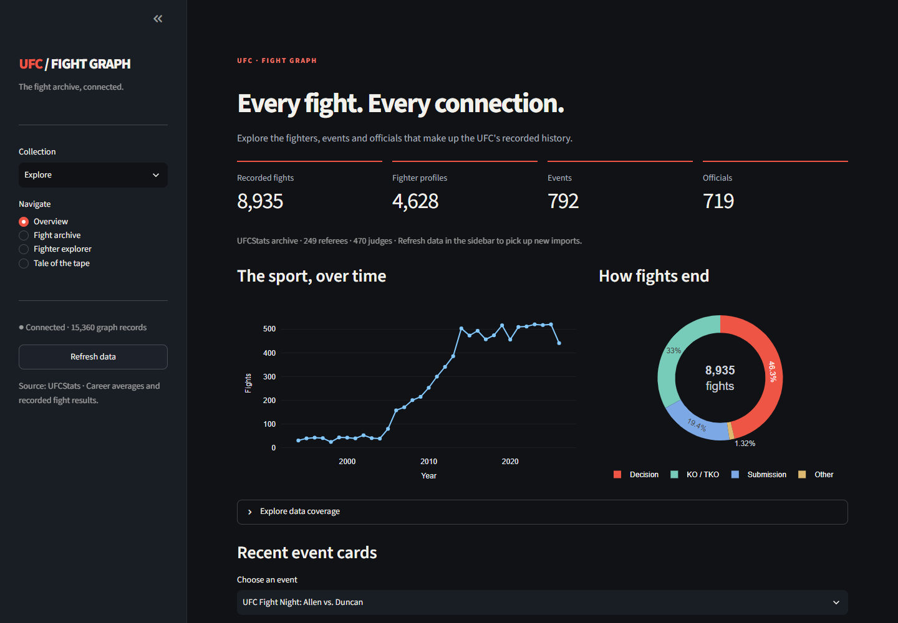

*Attach this image to post 1: Dashboard coverage and fight outcomes in one overview.*

## 2/12

The cleanup started with the difference between the commit descriptions and the running code. A previous architecture refactor had left earlier crawlers and dashboards alongside their replacements. There were also unused abstractions and overlapping documentation. I consolidated the project around one HTTP scraper, one graph writer and one dashboard. The retained docs explain setup, the graph schema, recovery and metric definitions. The audit records why obsolete files went away, while Git keeps the earlier versions available. That gives future fixes one clear implementation to target.

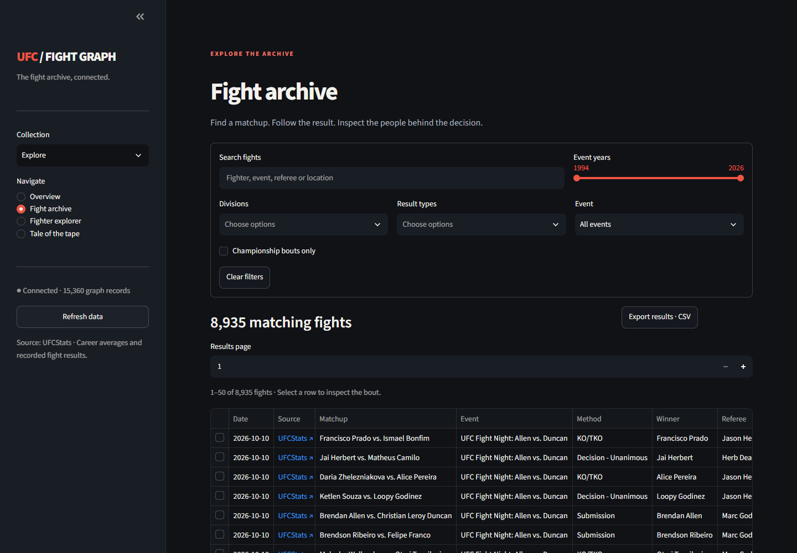

*Attach this image to post 2: Search, filter and inspect recorded bouts in the fight archive.*

## 3/12

The fight is the central record in the graph. Fighters connect to it through participation relationships that store their results. The fight belongs to an event, and the event connects to a location. Referees and judges connect directly to the bout, with published judge totals stored on the scoring relationships. The completed snapshot has 15,360 nodes and 57,759 relationships. This makes it straightforward to move between a fighter's history, their opponents and the officials attached to those fights. The dashboard is the browsing layer over that structure.

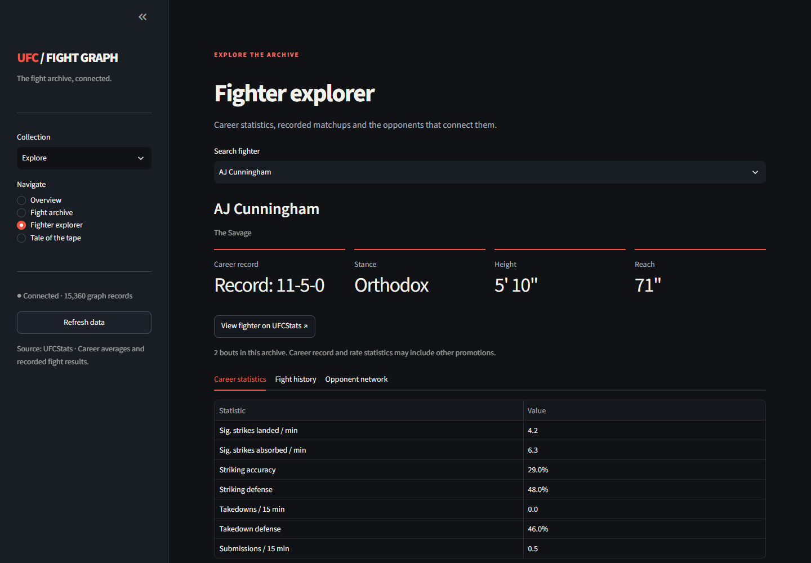

*Attach this image to post 3: A fighter profile connects career statistics with archived matchups.*

## 4/12

One important repair concerned identity. Two fighters can share a name, so merging records by name can combine different people's histories. Fighter records now use their UFCStats URLs as identifiers, and the dashboard distinguishes duplicate names in its selectors. Sparse updates also preserve properties that already contain data. These details are less visible than a chart, but they affect every chart built from the graph. I wanted a record's identity and update behaviour to be clear before loading the archive again.

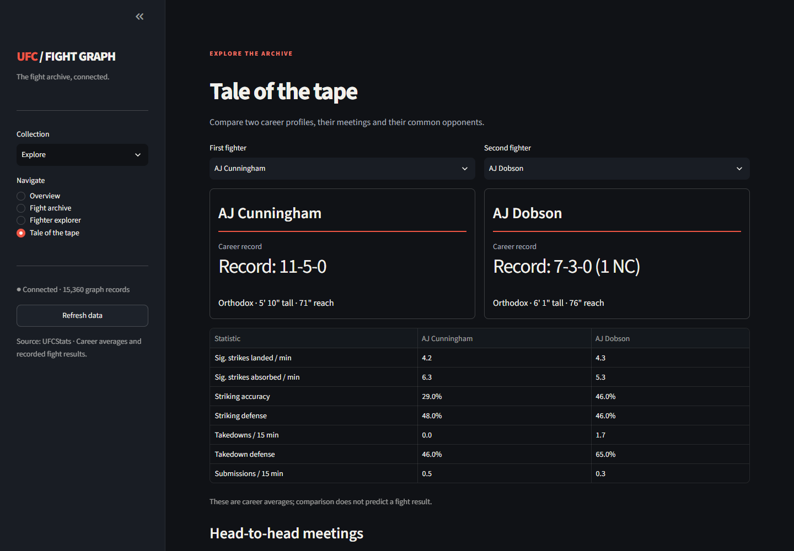

*Attach this image to post 4: Compare two profiles and their shared fight history.*

## 5/12

The crawl imports events, enriches eligible fights from their detail pages, and then loads fighter profiles. A checkpoint follows a successful database write. Failed URLs remain eligible for another attempt. That let me accelerate the remaining HTTP work without discarding completed records or restarting the entire crawl. Each worker owns its session and request pacing, while database writes and checkpoint updates remain serial. I have not published a controlled speed benchmark. The useful operational result is that the crawl can continue from saved progress after interruption.

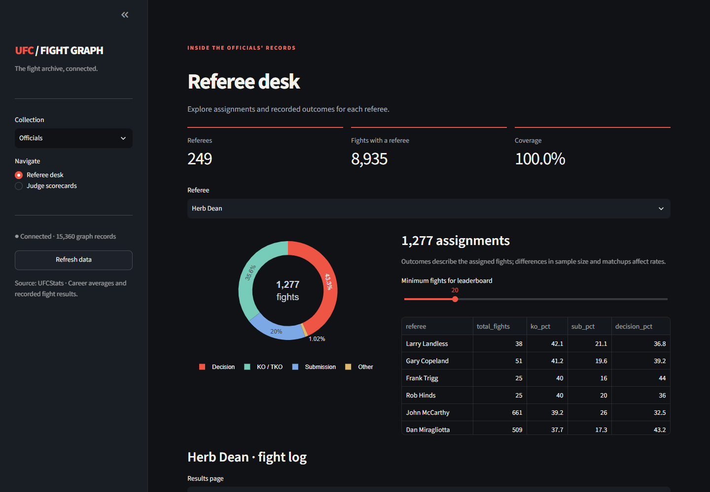

*Attach this image to post 5: Trace a referee’s assignments and recorded outcomes.*

## 6/12

Referees are now part of the rebuilt graph: 249 named referees with assignments across all 8,935 recorded fights. In the Referee desk, I can select an official, inspect their fight log and explore the recorded outcome distribution. The leaderboard also has a minimum-fight threshold. I keep the interpretation close to the chart: these rates describe the assigned fights. Matchups and sample sizes affect them. A finish-rate difference alone does not tell us whether one referee performs better than another. The source records remain available for inspection.

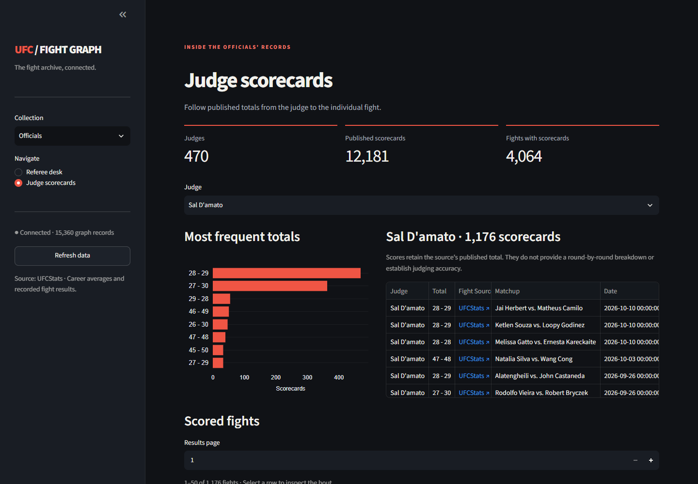

*Attach this image to post 6: Published judge totals linked to individual scored fights.*

## 7/12

Judges needed a separate coverage audit. Of 4,139 decision fights, 4,034 have all three named judges and totals. Seven have only one or two named judges, and 98 have no named judges. The completed crawl reached the fight pages, but some pages contain incomplete judging information. Spot-checks on UFCStats confirmed missing names or empty details. I documented those gaps because a successful crawl and complete field coverage are different claims. The next enrichment step needs additional sources, with provenance for every name or total added.

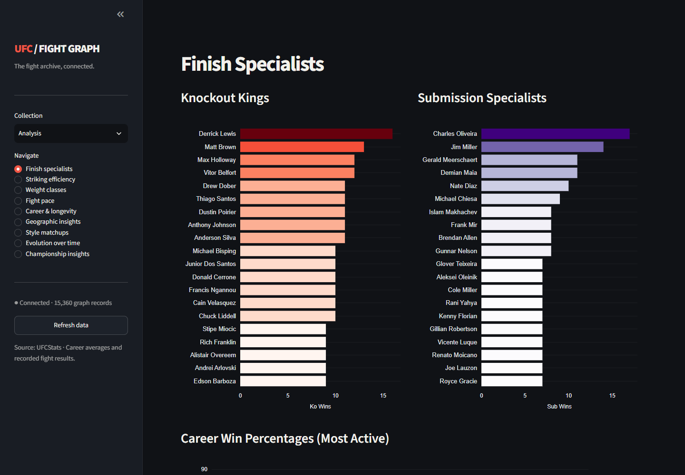

*Attach this image to post 7: Knockout and submission leaders across the archive.*

## 8/12

The dashboard's 4,064 fights with scorecards needs a precise explanation. It combines 4,041 decision fights with at least one named judge and 23 overturned results retaining scorecards. Among the 98 decisions without named judges, 42 still have anonymous totals in the raw fight details. The remaining 56 have no totals recorded. These records contain final totals, rather than round-by-round cards. Keeping those distinctions visible helps readers understand what the judge page can support and where another source would add value.

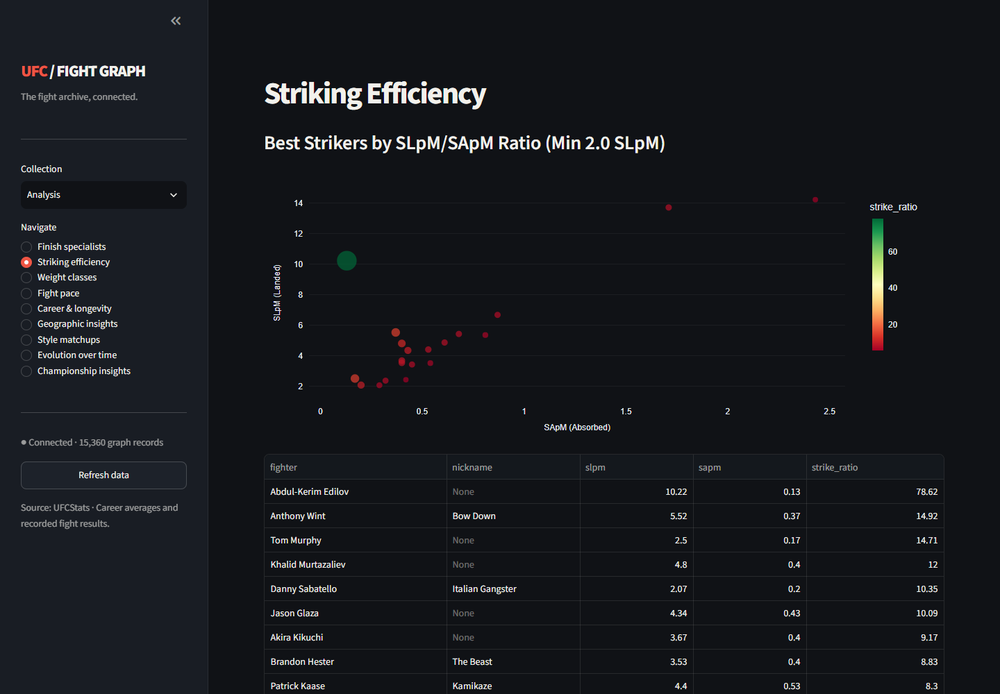

*Attach this image to post 8: Compare striking output, defense and reach-related results.*

## 9/12

The frontend now offers a searchable fight archive, fighter profiles, comparisons and dedicated officials pages. A Plotly world map covers 175 host locations across 31 countries and territories. I can switch between event and fight counts, then select a country to narrow the views below. Source links open UFCStats in a separate tab. I also adjusted long chart labels and axis margins for narrower layouts. These details make the archive easier to inspect, especially when a useful question starts in a chart and ends in an individual bout.

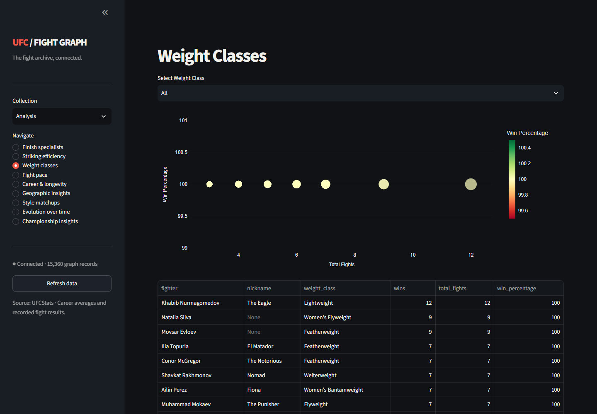

*Attach this image to post 9: Division-level records and fight-duration patterns.*

## 10/12

Losing the database changed the backup design. The final ZIP contains graph.json plus a checksum manifest, preserving node labels, properties and typed relationships with their endpoints. The graph JSON is about 17.21 MB, compressed to about 1.25 MB in the ZIP. Those are export sizes, rather than the Neo4j store size. A local rclone uploader sends the completed snapshot to Google Drive and verifies the copy. It runs independently of the AI conversation while the computer stays running and connected. Recovery targets a separate empty database.

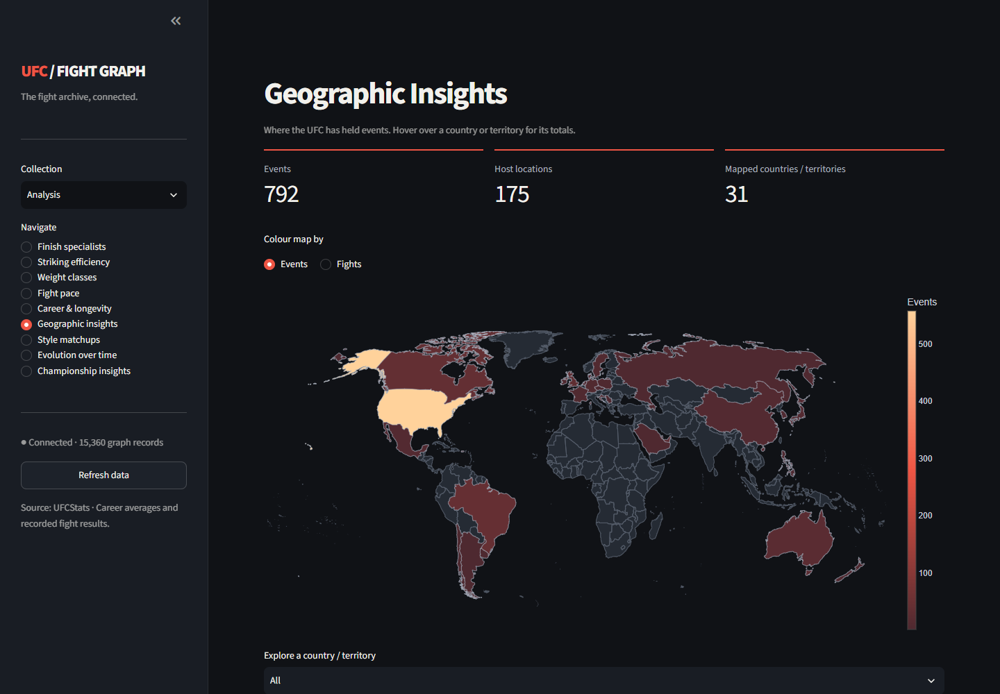

*Attach this image to post 10: A Plotly world map of event activity across host countries.*

## 11/12

The most useful result is that I can explain how a record reached the graph, inspect it in the dashboard and recover it from a backup. The initial recovery snapshot and final completed-crawl snapshot both uploaded successfully. I also kept the analytical scope explicit: career averages can include bouts outside this archive, and some network rankings use documented heuristics. The project now has a Streamlit Community Cloud deployment: https://ufc-fight-graph.streamlit.app/

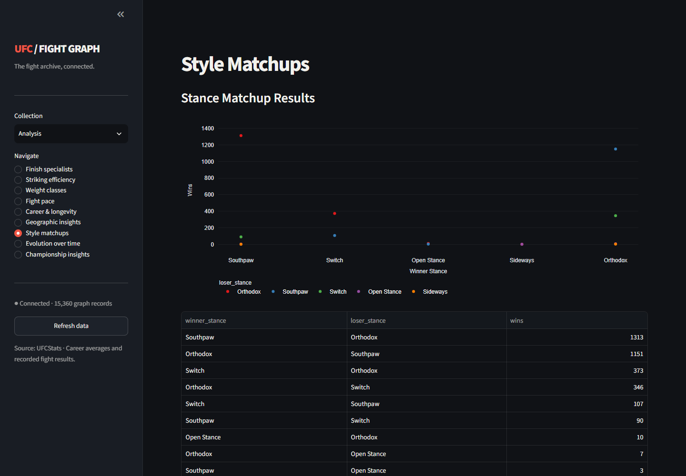

*Attach this image to post 11: Explore outcomes across stance matchups.*

## 12/12

The code, setup instructions, graph schema and coverage notes are on GitHub. My next data priority is completing judge information with traceable additional sources. I would also like feedback on which connections are most useful to explore: opponent histories, officials' assignments, geographic patterns or another question grounded in the available records. This rebuild has made the implementation easier to follow and the gaps easier to describe. The repository includes the operational details for running the app and restoring the graph. https://github.com/TheAlchemistNerd/ufc-fight-graph Explore the dashboard: https://ufc-fight-graph.streamlit.app/

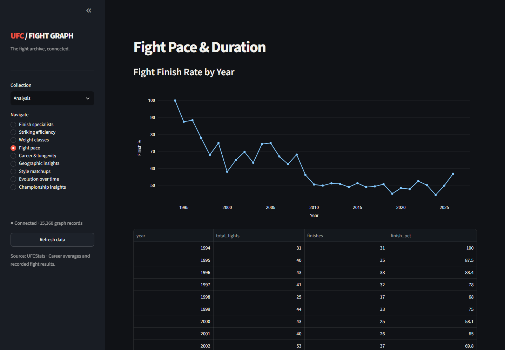

*Attach this image to post 12: Fight finishes by year and bout-duration patterns.*

## Project links

- [Live dashboard](https://ufc-fight-graph.streamlit.app/)
- [Project repository](https://github.com/TheAlchemistNerd/ufc-fight-graph)
- [Graph architecture](https://github.com/TheAlchemistNerd/ufc-fight-graph/blob/main/docs/ARCHITECTURE.md)
- [Judge coverage and recovery](https://github.com/TheAlchemistNerd/ufc-fight-graph/blob/main/docs/DATA_OPERATIONS.md#judge-coverage)
- [Code and history audit](https://github.com/TheAlchemistNerd/ufc-fight-graph/blob/main/docs/AUDIT.md)
- [Analytics definitions](https://github.com/TheAlchemistNerd/ufc-fight-graph/blob/main/docs/NETWORK_RESEARCH.md)
- [UFCStats source archive](http://ufcstats.com/statistics/events/completed?page=all)
